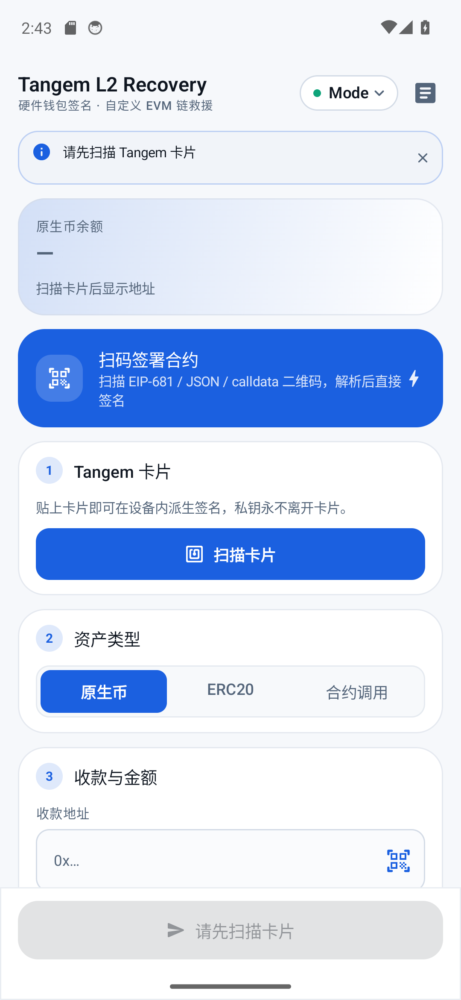
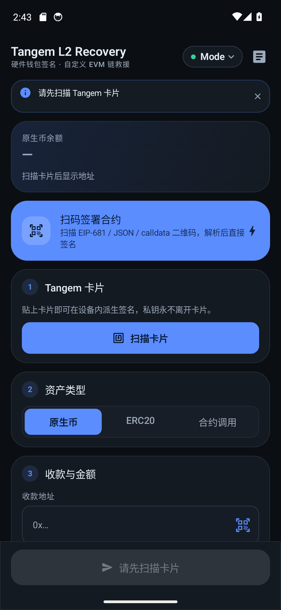
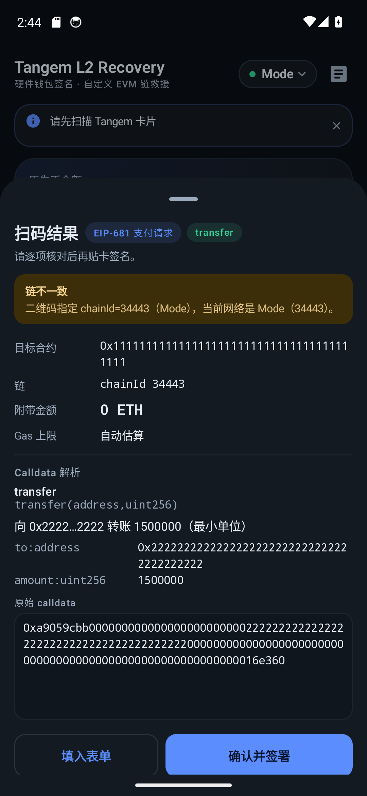
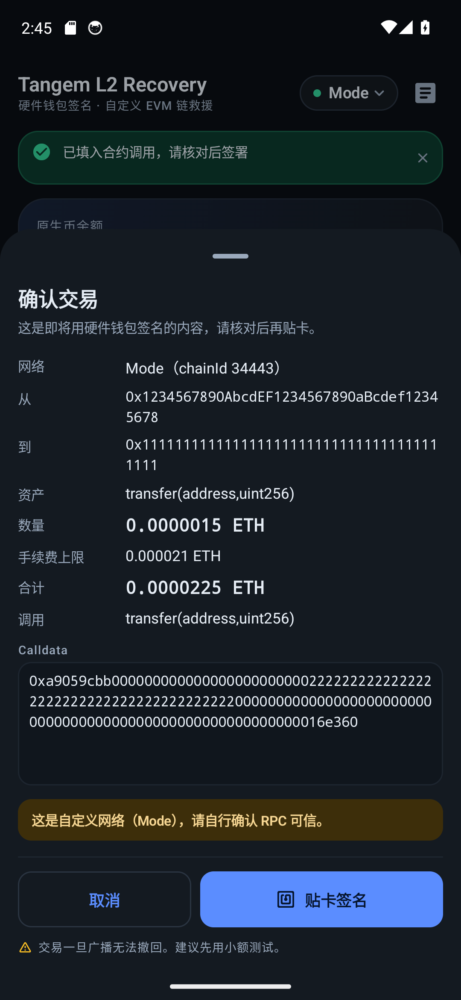
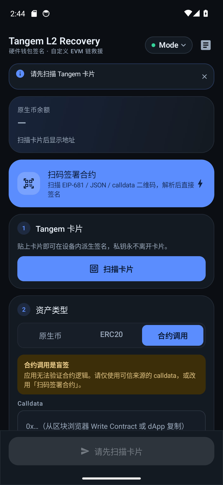
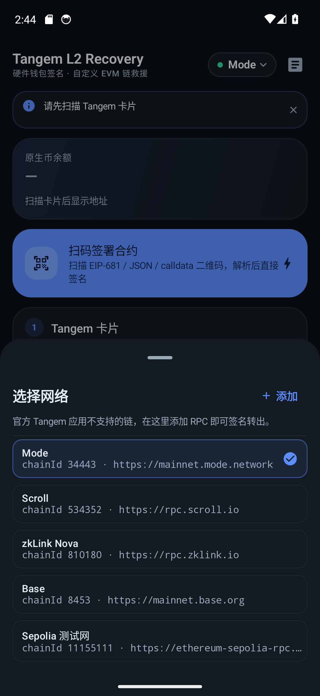
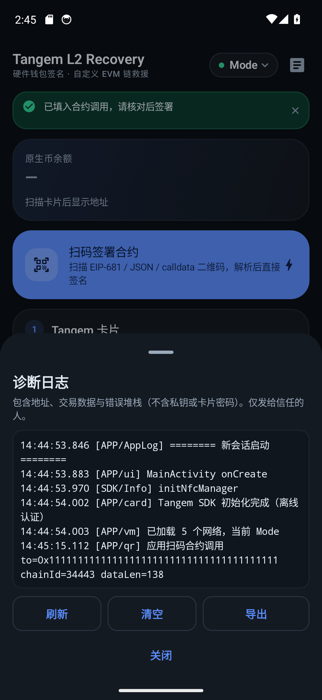

# Tangem L2 Recovery

**English** · [中文](README.zh-CN.md)

A minimal Android companion app for the **Tangem NFC hardware wallet**, built for signing
transactions on **L2 / EVM chains the official Tangem app does not support** (Mode,
Scroll, zkLink Nova, or any custom RPC).

## Why this exists

The official Tangem app only supports the networks baked into its closed-source
`blockchain-sdk`. If you bridge or receive tokens onto a chain it does not know about,
those assets are **invisible and unreachable** — the official app has no way to add a
custom RPC or chain id.

This tool is the escape hatch: add any EVM chain, tap your card, sign, broadcast. It also
works as a safety net, so nobody ends up with tokens stranded on an unreachable chain.

## Features

### Core
- Add **any custom EVM chain** (name + RPC; the chain id is read back from the node and
  verified, so an EIP-155 signature can never be bound to the wrong chain)
- Send **native coin**, **ERC-20 tokens**, or an **arbitrary contract call** (paste calldata)
- **Custom networks persist** across app restarts
- **Pre-signing review** of the exact transaction: network, chain id, from, to, asset,
  amount, fee ceiling, total and decoded calldata
- **Balance checks before signing** (`amount + gas > balance` is blocked before you tap
  the card, so no gas is wasted on a guaranteed revert)
- **Receipt verification** after broadcast, with live progress — distinguishes a real
  success from an on-chain revert instead of optimistically reporting "sent"
- Correct **L2 gas pricing** (uses the node's real price with a small buffer; no artificial
  1 gwei floor) plus `eth_estimateGas`
- QR scanning for recipient addresses
- **"全部余额"** fills the exact balance using integer arithmetic (no floating-point drift)
- On-device **persistent diagnostics log** with export
- Light **and dark** themes, both contrast-checked

### New in v2 — scan a QR code to sign a contract call
A dedicated **扫码签署合约** entry point decodes a QR payload, shows a review sheet with the
decoded call, and signs + broadcasts it with the card.

| Payload | Example |
|---|---|
| EIP-681 with a function | `ethereum:0xTOKEN@34443/transfer?address=0xABC&uint256=1000000` |
| EIP-681 with raw data | `ethereum:0xCONTRACT@8453?data=0xdeadbeef&value=0` |
| JSON transaction | `{"to":"0x…","data":"0x…","value":"0","chainId":34443}` |
| Bare calldata | `0xa9059cbb000…` (asks for the target contract) |
| Bare address | `0xabc…` (recipient only) |
| URL with query | `https://dapp.example/claim?to=0x…&data=0x…&chainId=34443` |
| WalletConnect | `wc:…` → recognised and reported as unsupported |

Calldata is decoded against a registry of well-known methods (ERC-20 / ERC-721 / staking /
bridging / claim entry points). **Unknown selectors are shown as an explicit blind-signing
warning** — the app never pretends it understood a call it did not.

## Architecture

MVVM with Compose, coroutines and `StateFlow`. Money-moving logic is isolated from the UI
and covered by unit tests.

```
domain/            RecoveryUiState, RecoveryActions, RecoveryViewModel
domain/model/      pure data types
data/rpc/          JSON-RPC transport (retry + backoff) and typed eth_* calls
data/abi/          ERC-20 encoding, calldata decoder
data/tx/           legacy EIP-155 encoding + signature assembly
data/card/         Tangem SDK bridge (scan / derive / sign)
data/network/      network persistence
data/token/        ERC-20 metadata service
data/qr/           QR payload parser
core/util/         exact decimal units, address validation (EIP-55)
core/log/          asynchronous diagnostics log
ui/theme/          Compose design system
ui/components/     reusable widgets
ui/screens/        screen composables
```

`MainActivity` is a `FragmentActivity` (the Tangem SDK hosts its NFC session in a
`DialogFragment`), owns the zxing scan launcher, and forwards events to the ViewModel.

## Screenshots

| Main (light) | Main (dark) |
|---|---|
|  |  |

| QR review | Confirm |
|---|---|
|  |  |

| Contract mode | Network picker | Diagnostics |
|---|---|---|
|  |  |  |

Captured on an Android 14 emulator (1080×2340); see `docs/screenshots/`.

## Build

Requires **JDK 17** and **Android SDK 34** (platform + build-tools).

```bash
./gradlew assembleRelease   # distributable APK — R8 minified, ~5.9 MB
./gradlew assembleDebug     # development only — unminified, ~32 MB
```

The release build is what ships as `release/TangemL2Recovery.apk` and on the
[Releases page](https://github.com/nfeuism/Tangem-L2/releases). R8 removes the
unused parts of web3j's transitive dependencies, the unused Material icon set and
unused Compose code paths, cutting the APK by ~82%. It is signed with the debug
keystore on purpose: this project ships an openly reviewable, sideloadable APK,
not a Play Store artifact. Keep rules for the Tangem NFC stack are deliberately
conservative (see `app/proguard-rules.pro`) — a missing class at signing time is
far worse than a slightly larger APK.

The Tangem SDK is vendored in `offline-repo/`, so the project resolves it without any
local Maven setup.

### If your network cannot reach Google Maven reliably
Some networks get intermittent 404s from Google's Maven CDN for artifacts that
definitely exist. `build-env/` contains an optional helper: it auto-detects a JDK 17
and the Android SDK, then starts a local retrying/caching mirror and points Gradle
at it.

```bash
./build-env/build.sh assembleRelease
./build-env/build.sh testDebugUnitTest
USE_MAVEN_PROXY=0 ./build-env/build.sh assembleRelease   # skip the proxy
```

It is a build-environment shim only — it does not affect the app or its dependencies.
On a normal network, plain `./gradlew assembleRelease` works fine.

## Tests

```bash
./gradlew testDebugUnitTest
```

37 unit tests cover the highest-risk logic:

- **EIP-155 signing**: the reference signing hash from the EIP-155 spec, plus a
  byte-for-byte differential test against web3j's own signer, plus a large-chain-id
  (Scroll, 534352) case where `v` no longer fits in one byte, plus rejection of a
  mismatched public key
- Exact decimal parsing/formatting with no floating-point drift and explicit
  precision-overflow rejection
- EIP-55 checksum against the official test vectors
- All QR payload shapes, WalletConnect rejection, and no-throw behaviour on garbage input
- Calldata decoding, including legacy `bytes32` and dynamic `string` token symbols

## Optional: bind to your own address

`app/src/main/java/com/example/tangeml2/domain/model/Network.kt` contains
`EXPECTED_ADDRESS`, **empty by default** (a generic, address-agnostic tool). Fill it in if
you want the app to verify that a scanned card derives a known address.

## ⚠️ Security notes

- The card's **access code (PIN)** is enforced natively by the Tangem SDK. This app adds
  **no custom cryptography** and never sees the private key.
- **"合约调用" and unknown QR payloads are blind signing.** The app cannot verify contract
  logic. Only sign calldata you trust.
- **Always test with a tiny amount first.** L2 gas behaviour differs between chains
  (zkSync-stack chains in particular).
- Debug-signed APK. Review the source before using it with real funds.
