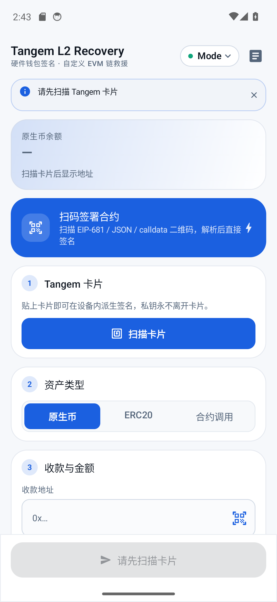
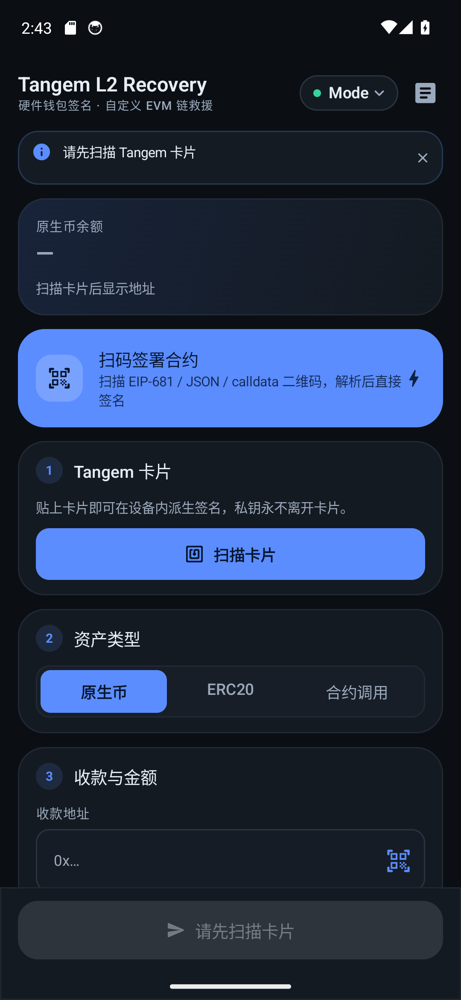
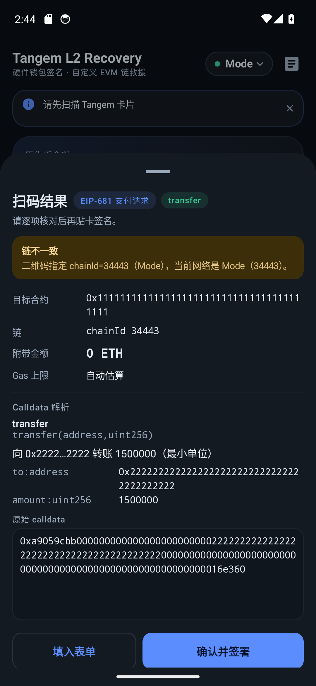
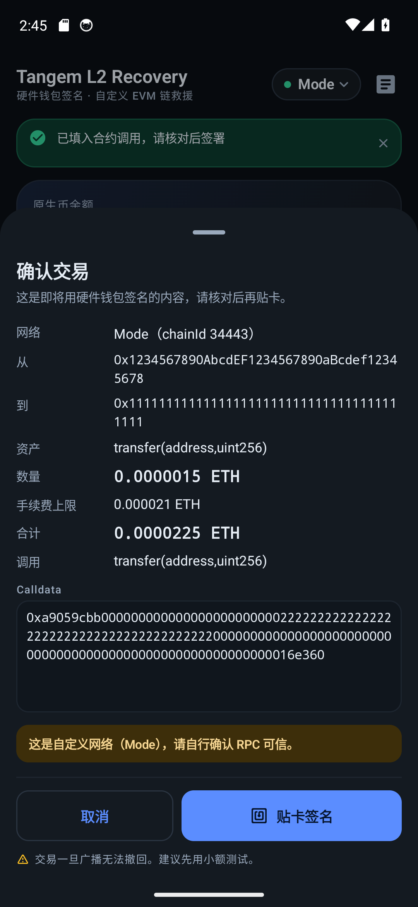
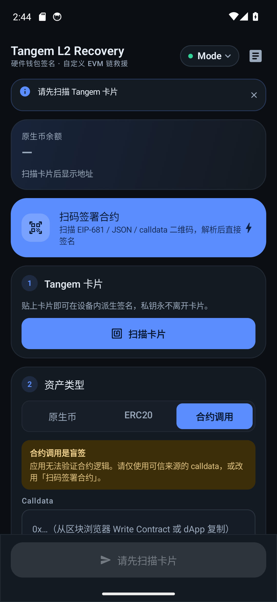
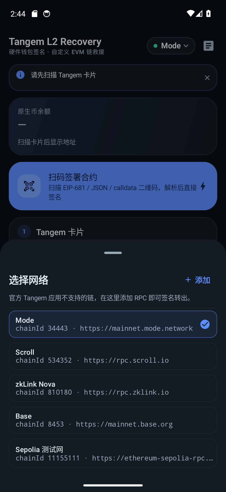
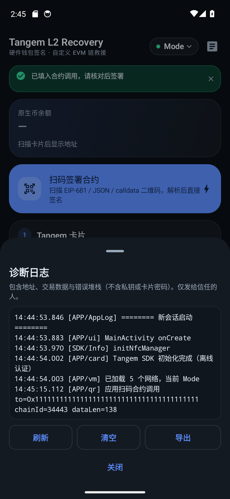

# Tangem L2 Recovery

[English](README.md) · **中文**

一个极简的 **Tangem NFC 硬件钱包** 安卓伴侣应用，专为在 **Tangem 官方应用不支持的 L2 /
EVM 网络**（Mode、Scroll、zkLink Nova，或任意自定义 RPC）上签名交易而做。

## 为什么需要它

官方 Tangem 应用只支持其闭源 `blockchain-sdk` 内置的网络。如果你把代币跨链或接收到了
它未收录的网络，这些资产在官方应用里会 **看不到、也动不了** —— 官方应用**不支持添加
自定义 RPC / chainId**。

本工具就是那条逃生通道：添加任意 EVM 链，贴卡，签名，广播。它同时也是一道防线 ——
避免有人不小心把代币转入官方应用够不到的网络后无法取回。

## 功能

### 核心
- 添加**任意自定义 EVM 链**（名称 + RPC；chainId 从节点回读并校验，杜绝 EIP-155 签错链）
- 发送**原生币**、**ERC-20 代币**，或**任意合约调用**（粘贴 calldata）
- **自定义网络持久化**，重启 App 不会丢
- 发送前的**完整交易确认**：网络、chainId、from、to、资产、金额、手续费上限、合计、解码后的 calldata
- 发送前**余额校验**（`金额 + gas > 余额` 时直接拦下，不浪费贴卡与 gas）
- 广播后**回链核实 receipt**，并显示实时进度 —— 区分真正的成功与链上 revert，不再假报「已发送」
- 正确的 L2 **gas 定价**（用网络实价 + 小幅缓冲，不再强行抬到 1 gwei 地板）+ `eth_estimateGas`
- 收款地址**二维码扫描**
- **「全部余额」**用整数精确填入，杜绝浮点上浮导致超额
- 设备内**持久化诊断日志** + 导出
- **浅色 / 深色**双主题，均通过对比度检查

### v2 新增：扫码直接签署合约
独立的 **「扫码签署合约」** 入口，解码二维码 → 弹出核对面板（含 calldata 解析）→ 贴卡签名并广播。

| 二维码内容 | 示例 |
|---|---|
| EIP-681（带函数） | `ethereum:0xTOKEN@34443/transfer?address=0xABC&uint256=1000000` |
| EIP-681（带原始 data） | `ethereum:0xCONTRACT@8453?data=0xdeadbeef&value=0` |
| JSON 交易描述 | `{"to":"0x…","data":"0x…","value":"0","chainId":34443}` |
| 裸 calldata | `0xa9059cbb000…`（会要求手动填目标合约） |
| 裸地址 | `0xabc…`（仅作为收款地址） |
| 带参数的 URL | `https://dapp.example/claim?to=0x…&data=0x…&chainId=34443` |
| WalletConnect | `wc:…` → 识别为不支持并明确提示 |

calldata 会按常见方法注册表解码（ERC-20 / ERC-721 / 质押 / 跨链 / 领取等）。
**未知函数一律显示「盲签」警告** —— 应用绝不假装看懂了自己没看懂的调用。

## 架构

MVVM + Compose + 协程 + `StateFlow`。涉及资金的逻辑与 UI 隔离，并有单元测试覆盖。

```
domain/            RecoveryUiState、RecoveryActions、RecoveryViewModel
domain/model/      纯数据类型
data/rpc/          JSON-RPC 传输（重试 + 退避）与类型化 eth_* 调用
data/abi/          ERC-20 编码、calldata 解码器
data/tx/           Legacy EIP-155 编码与签名组装
data/card/         Tangem SDK 桥接（扫卡 / 派生 / 签名）
data/network/      网络持久化
data/token/        ERC-20 元数据服务
data/qr/           二维码内容解析
core/util/         精确十进制单位换算、地址校验（EIP-55）
core/log/          异步诊断日志
ui/theme/          Compose 设计系统
ui/components/     可复用组件
ui/screens/        界面
```

`MainActivity` 继承 `FragmentActivity`（Tangem SDK 的 NFC 会话是 `DialogFragment`），
持有 zxing 扫码 launcher，并把事件转给 ViewModel。

## 界面

| 主界面（浅色） | 主界面（深色） |
|---|---|
|  |  |

| 扫码结果 | 交易确认 |
|---|---|
|  |  |

| 合约调用模式 | 网络选择 | 诊断日志 |
|---|---|---|
|  |  |  |

全部截图由 Android 14 模拟器（1080×2340）实拍，见 `docs/screenshots/`。

## 编译

需要 **JDK 17** 与 **Android SDK 34**（platform + build-tools）。

```bash
./gradlew assembleRelease   # 分发用：R8 裁剪，约 5.9 MB
./gradlew assembleDebug     # 仅开发用：未裁剪，约 32 MB
```

`release/TangemL2Recovery.apk` 与 [Releases 页面](https://github.com/nfeuism/Tangem-L2/releases)
上的安装包都是 **release 构建**。R8 会摇掉 web3j 传递依赖里未使用的部分、未使用的
Material 图标集和未使用的 Compose 代码路径，体积减少约 82%。它特意用 debug keystore
签名：本项目交付的是可公开审阅、可侧载的 APK，不是应用商店产物。
Tangem NFC 栈的 keep 规则刻意保守（见 `app/proguard-rules.pro`）—— 对钱包来说，
贴卡签名时缺类比 APK 稍大一点严重得多。

Tangem SDK 已内置在 `offline-repo/`，clone 即可编译，不依赖本机 Maven 配置。

### 网络无法稳定访问 Google Maven 时
部分网络下 Google Maven CDN 会对确实存在的依赖间歇性返回 404。`build-env/` 提供了一个
可选辅助脚本：自动探测 JDK 17 与 Android SDK，启动本地镜像/重试代理并让 Gradle 走它：

```bash
./build-env/build.sh assembleRelease
./build-env/build.sh testDebugUnitTest
USE_MAVEN_PROXY=0 ./build-env/build.sh assembleRelease   # 跳过代理
```

它只是构建环境补丁，不影响 App 本身。网络正常时直接用 `./gradlew assembleRelease` 即可。

## 测试

```bash
./gradlew testDebugUnitTest
```

37 个单元测试覆盖风险最高的逻辑：

- **EIP-155 签名**：EIP-155 规范中的参考签名哈希、与 web3j 参考实现逐字节对拍、
  大 chainId（Scroll 534352，`v` 超出 1 字节）场景、公钥不匹配时必须拒绝
- 精确十进制解析/格式化（无浮点漂移）、超精度输入必须报错
- EIP-55 校验和对照官方测试向量
- 全部二维码格式、WalletConnect 拒绝、垃圾输入不抛异常
- calldata 解码，含 legacy `bytes32` 与动态 `string` 代币符号

## 可选：绑定你自己的地址

`app/src/main/java/com/example/tangeml2/domain/model/Network.kt` 里的 `EXPECTED_ADDRESS`
**默认为空**（通用工具，不绑定任何地址）。如需让应用在扫卡时校验派生地址是否与已知地址
一致，填入你自己的地址即可。

## ⚠️ 安全须知

- 卡片的**访问密码（PIN）**由 Tangem SDK 原生强制，本应用**不添加任何自定义加解密**，
  也永远看不到私钥。
- **「合约调用」与未知二维码内容是盲签** —— 应用无法验证合约逻辑，只签署你信任来源的 calldata。
- **务必先用极小额测试。** L2（尤其 zkSync 栈链）的 gas 行为有差异。
- Debug 签名 APK。动真钱前请先审阅源码。
